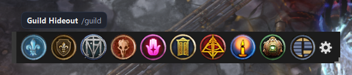
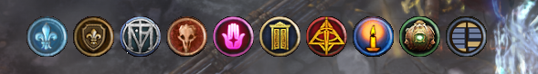
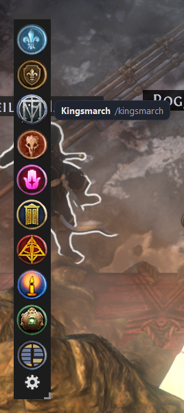
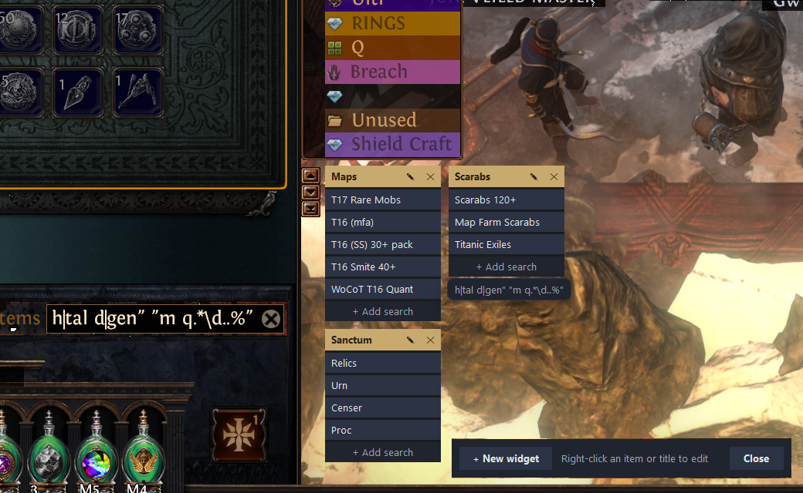
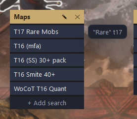
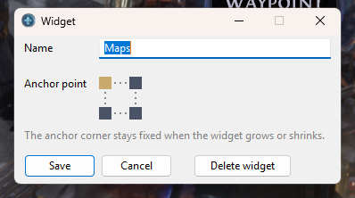
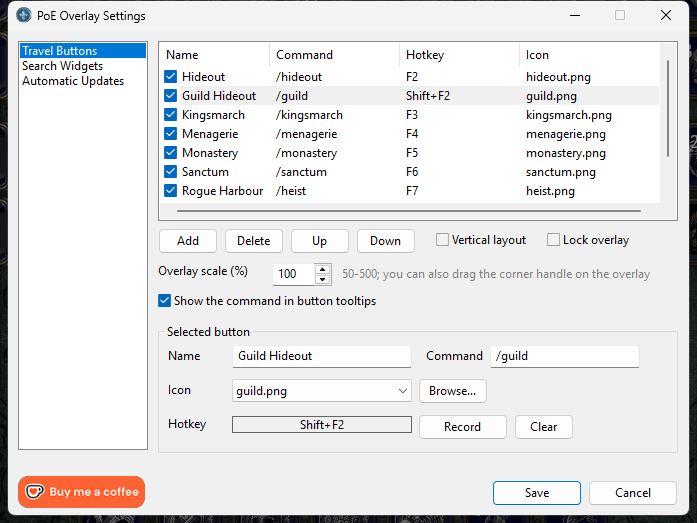
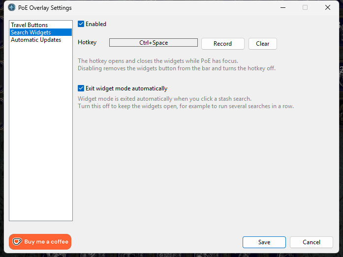
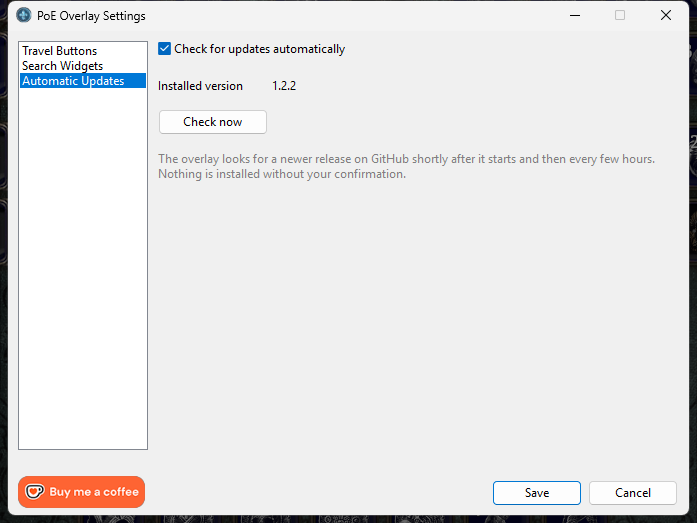

# PoE Overlay

A small floating bar of buttons for Path of Exile (PoE 1), written in AutoHotkey v2. Each button runs a chat command in game, such as `/hideout`, with one click or a hotkey.

The bar only shows while the PoE window has focus. Clicking it never takes focus from the game.

## Features

- Default buttons: Hideout (`/hideout`), Guild Hideout (`/guild`), Kingsmarch (`/kingsmarch`), Menagerie (`/menagerie`), Monastery (`/monastery`), Sanctum (`/sanctum`), Rogue Harbour (`/heist`), Mine Encampment (`/delve`) and The Sovereign (`/boat`)
- Stash widgets: a built-in button (next to the cog) opens draggable panels of saved stash searches. Click one to search your stash (Ctrl+F, then paste).
- Icons, 47x47 px per button at 100% scale 
- Click a button, or press its hotkey, to send the command
- A settings panel (the cog button) to:
  - add, delete and reorder buttons, and enable or disable each one with its checkbox
  - change each button's name, command and icon
  - record a hotkey for each button
  - switch between horizontal and vertical layout
  - set the overlay scale (50-500%)
  - choose whether button tooltips show the command next to the name (on by default)
  - lock the overlay so it can't be moved or resized
- Draggable bar. Its position is remembered.
- Resizable bar: drag the corner handle to scale the button images uniformly (50% to 500%). The cog, grip and handle keep their size. The scale is remembered.
- Minimal look: until you hover the bar, only the button images are shown. The background, move grip, cog and resize handle appear on hover.
- Lock option: when locked, hovering only reveals the cog; the background, move grip and resize handle stay hidden, so the bar can't be moved or resized by accident.

## Screenshots



*Hover a button to see its name and command. The move grip and the settings cog appear on hover.*

| Idle | Vertical layout |
| --- | --- |
|  |  |
| *Until you hover it, only the icons show.* | *The bar can also run vertically; tooltips then appear to the right.* |

### Stash search widgets



*The Stash widgets button (next to the cog) opens your widgets and a toolbar for adding more. Click a search to run it in your stash; hovering one shows the search string it will use.*

| Search string tooltip | Widget settings |
| --- | --- |
|  |  |
| *Hover a search to see the string it will use.* | *Rename a widget and pick which corner stays fixed when it grows.* |

### Settings



*Travel Buttons: add, reorder, enable and edit buttons, record hotkeys, and set layout, lock, scale and whether tooltips show the command.*



*Search Widgets: turn the feature on or off and record a hotkey that opens and closes the widgets, and choose whether a search closes them.*



*Automatic Updates: the installed version, a manual check, and whether to check on its own. Nothing is installed without your confirmation.*

## How it works

When you click a button, the script:

1. saves your clipboard
2. puts the command on the clipboard
3. presses Enter, Ctrl+V, then Enter in the game
4. restores your original clipboard

## Requirements

- Windows
- [AutoHotkey v2](https://www.autohotkey.com/) (2.0 or newer)
- Path of Exile in **windowed** or **windowed fullscreen (borderless)** mode. Overlays can't draw over exclusive fullscreen.

## Installation

1. Install AutoHotkey v2.
2. Download or clone this repository.
3. Run `overlay.ahk` with the v2 interpreter. Either double-click it, or use the shortcut described below.
4. Start PoE. The bar appears near the top-left of the screen.

### Running with v2 when v1 is also installed

If AutoHotkey v1 is installed as well, `.ahk` files may open with the wrong version. Create a shortcut that names the v2 interpreter explicitly:

```
"C:\Program Files\AutoHotkey\v2\AutoHotkey64.exe" "C:\path\to\poe-overlay\overlay.ahk"
```

Adjust both paths to your install. Set the shortcut's **Start in** to the repository folder. You can place the shortcut on the desktop or in `shell:startup` to run it at login.

### If PoE runs as administrator

If PoE is running elevated, this script may also need to run as administrator. Windows blocks a non-elevated program from sending keystrokes to an elevated one, so without admin rights the buttons will do nothing in game.

The script does not elevate itself. To run it as administrator, right-click the shortcut and choose **Run as administrator**. To make that permanent, open the shortcut's Properties, choose Advanced, and tick **Run as administrator**.

## Usage

- **Show the controls:** move the mouse over the bar. The grip, cog and resize handle only appear while you hover it.
- **Move the bar:** drag the dark grip strip at its edge.
- **Scale the bar:** drag the corner edge (a small "┘" shape) in the bottom-right corner. Dragging away from the bar enlarges it and dragging toward it shrinks it. The bar can't go below 50%.
- **Lock the bar:** tick "Lock overlay" in settings. While locked, hovering shows only the cog (to open settings and unlock it again), with no background, grip or resize handle.
- **Run a command:** click a button, or press its hotkey while PoE has focus.
- **Open settings:** click the cog. A list on the left switches between the **Travel Buttons**, **Search Widgets** and **Automatic Updates** pages.
  - On Travel Buttons, select a row to edit it. **Add**, **Delete**, **Up** and **Down** manage the list. Untick a row's checkbox to hide that button and its hotkey without deleting it.
  - **Record** captures the next key combination you press. Esc cancels, and **Clear** removes the hotkey.
  - **Save** applies your changes. **Cancel** discards them.
- **Stash widgets:** click the Stash widgets button (just left of the cog) to open them, and click it again, use **Close** in the toolbar, or press **Esc** to close them. See below.
- **Tray menu:** the AutoHotkey tray icon has Settings, Reload and Exit.

Hotkeys only work while PoE has focus, and each one replaces that key's normal function in game. Plain Enter can't be used.

## Stash widgets

A widget is a titled panel of saved stash searches. Open them with the **Stash widgets** button in the bar. A toolbar appears at the bottom middle of the PoE window, and the widgets appear where you left them. Everything outside the widgets and toolbar still clicks through to the game, so you can search while they are open.

- **Search:** click an item. Its search string is copied, then Ctrl+F and Ctrl+V are sent. The search string stays on your clipboard (unlike chat commands, which restore it), and the widgets close. Untick **Exit widget mode automatically** on the Search Widgets settings page to keep them open after a search.
- **New widget:** **+ New widget** in the toolbar. It opens at the centre of the window and asks for a name.
- **Move:** drag the widget's title bar. The position is remembered.
- **Rename, anchor or delete:** the pencil and cross at the right of the title (or right-click the title). The pencil dialog also sets the **anchor point**: click one of the four corners (top left by default). That corner stays fixed when the widget grows or shrinks, so a bottom-right widget grows up and to the left. Changing the anchor keeps the widget where it is. Deleting a widget that has searches asks for confirmation.
- **Add a search:** **+ Add search** at the bottom of a widget. The name can be anything; leave it empty to use the search string.
- **Edit, delete or reorder a search:** right-click it.

The widgets are saved in `widgets.ini` next to the script (not tracked by git, and not touched by updates). They start closed after a restart.

On the **Search Widgets** settings page you can turn the feature off (**Enabled**) and record a **hotkey** that opens and closes the widgets while PoE has focus. When disabled, the button disappears from the bar and the hotkey stops working.

The Stash widgets button is built in, like the cog: it always sits right before the cog, scales with the other buttons, and isn't part of the editable button list (so it is configured on its own settings page instead). Its icon is `icons/widgets.png`.

## Updates

The overlay checks GitHub for a newer release shortly after startup and then every few hours (turn this off with **Check for updates automatically** on the Automatic Updates settings page). The check runs in the background and fails silently when you are offline.

When a newer version exists:

- a tray notification appears, but only while PoE is not focused, so it never interrupts a game;
- the tray menu gets an **Update available** entry, and the tray tooltip says so;
- clicking either opens a dialog with **Update now**, **Later** and **Skip this version**.

Nothing is ever installed without your confirmation. **Update now** downloads the release zip, checks it, backs up the files it replaces, copies the new files over the install and restarts the overlay. If anything goes wrong the old files are restored. Your `settings.ini` is not part of the release, so your buttons, hotkeys and position are kept. Built-in files such as the default icons are replaced.

You can also check manually from the tray menu (**Check for updates**) or with **Check now** on the Automatic Updates page. Updates need `curl.exe` and `tar.exe`, which ship with Windows 10 and 11.

## Configuration

Settings are stored in `settings.ini` next to the script. It is created on first run and is not tracked by git. Delete it to restore the defaults. The default button list only applies when no `settings.ini` exists, so an existing file keeps its own buttons.

Each button is saved as a `[ButtonN]` section with `name`, `icon`, `command`, `hotkey` and `enabled` (1 or 0). A section without `enabled`, for example from an older version, counts as enabled.

Icons live in `icons/`. To use your own, drop a PNG there (47x47 works best) and pick it in settings, or use **Browse...** to pick one from anywhere.

## Project layout

```
overlay.ahk              entry point
VERSION                  current version (read by the script, checked by the release workflow)
lib/config.ahk           settings and button list (settings.ini)
lib/commands.ahk         sending chat commands, hotkey registration
lib/overlay.ahk          the floating button bar
lib/widgets.ahk          stash search widgets (widgets.ini)
lib/settings.ahk         the settings panel
lib/updater.ahk          update check and installer
lib/version.ahk          reads VERSION
icons/                   button icons (PNG)
tools/generate-icons.ps1 icon generator
```

## Troubleshooting

- **Nothing happens in game:** run the script as administrator (see above), and make sure PoE is not in exclusive fullscreen.
- **The bar doesn't appear:** PoE must have focus. The window class is expected to be `POEWindowClass`.
- **The command is cut off or sent too early:** the short delays in `SendChat` (`lib/commands.ahk`) can be raised if your chat box opens slowly.
- **Wrong AutoHotkey version error:** open the script through the v2 shortcut above.
