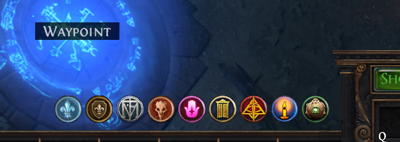
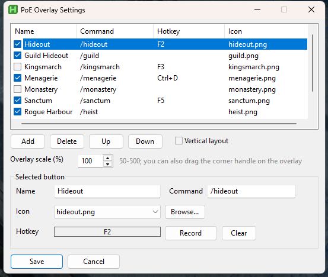

# PoE Overlay

A small floating bar of buttons for Path of Exile (PoE 1), written in AutoHotkey v2. Each button runs a chat command in game, such as `/hideout`, with one click or a hotkey.

The bar only shows while the PoE window has focus. Clicking it never takes focus from the game.

| The overlay in game | The settings panel |
| --- | --- |
|  |  |

## Features

- Default buttons: `/hideout`, `/kingsmarch`, `/boat`, `/menagerie`, `/sanctum`
- 24x24 monotone icons
- Click a button, or press its hotkey, to send the command
- A settings panel (the cog button) to:
  - add, delete and reorder buttons
  - change each button's name, command and icon
  - record a hotkey for each button
  - switch between horizontal and vertical layout
- Draggable bar. Its position is remembered.

## How it works

When you click a button, the script:

1. saves your clipboard
2. puts the command on the clipboard
3. presses Enter, Ctrl+V, then Enter in the game
4. restores your original clipboard

## Requirements

- Windows
- [AutoHotkey v2](https://www.autohotkey.com/) (2.0 or newer)
- Path of Exile in **windowed** or **windowed fullscreen (borderless)** mode. Overlays can't draw over exclusive fullscreen.

## Installation

1. Install AutoHotkey v2.
2. Download or clone this repository.
3. Run `overlay.ahk` with the v2 interpreter. Either double-click it, or use the shortcut described below.
4. Start PoE. The bar appears near the top-left of the screen.

### Running with v2 when v1 is also installed

If AutoHotkey v1 is installed as well, `.ahk` files may open with the wrong version. Create a shortcut that names the v2 interpreter explicitly:

```
"C:\Program Files\AutoHotkey\v2\AutoHotkey64.exe" "C:\path\to\poe-overlay\overlay.ahk"
```

Adjust both paths to your install. Set the shortcut's **Start in** to the repository folder. You can place the shortcut on the desktop or in `shell:startup` to run it at login.

### If PoE runs as administrator

If PoE is running elevated, this script may also need to run as administrator. Windows blocks a non-elevated program from sending keystrokes to an elevated one, so without admin rights the buttons will do nothing in game.

The script does not elevate itself. To run it as administrator, right-click the shortcut and choose **Run as administrator**. To make that permanent, open the shortcut's Properties, choose Advanced, and tick **Run as administrator**.

## Usage

- **Move the bar:** drag the dark grip strip at its edge.
- **Run a command:** click a button, or press its hotkey while PoE has focus.
- **Open settings:** click the cog.
  - Select a row to edit it. **Add**, **Delete**, **Up** and **Down** manage the list.
  - **Record** captures the next key combination you press. Esc cancels, and **Clear** removes the hotkey.
  - **Save** applies your changes. **Cancel** discards them.
- **Tray menu:** the AutoHotkey tray icon has Settings, Reload and Exit.

Hotkeys only work while PoE has focus, and each one replaces that key's normal function in game. Plain Enter can't be used.

## Configuration

Settings are stored in `settings.ini` next to the script. It is created on first run and is not tracked by git. Delete it to restore the defaults.

Icons live in `icons/`. To use your own, drop a PNG there (24x24 works best) and pick it in settings, or use **Browse...** to pick one from anywhere.

## Project layout

```
overlay.ahk              entry point
lib/config.ahk           settings and button list (settings.ini)
lib/commands.ahk         sending chat commands, hotkey registration
lib/overlay.ahk          the floating button bar
lib/settings.ahk         the settings panel
icons/                   button icons (PNG)
tools/generate-icons.ps1 icon generator
```

## Troubleshooting

- **Nothing happens in game:** run the script as administrator (see above), and make sure PoE is not in exclusive fullscreen.
- **The bar doesn't appear:** PoE must have focus. The window class is expected to be `POEWindowClass`.
- **The command is cut off or sent too early:** the short delays in `SendChat` (`lib/commands.ahk`) can be raised if your chat box opens slowly.
- **Wrong AutoHotkey version error:** open the script through the v2 shortcut above.
